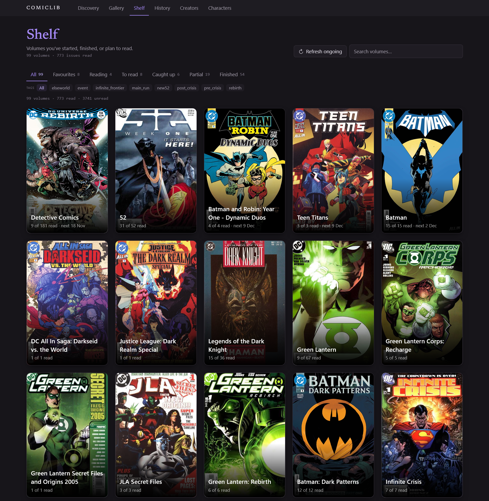

# ComicLib


A local-first, typed Node.js + React application built on top of the [ComicVine](https://comicvine.gamespot.com/) API. It started as a single function that answered one question, *which issues contain these two characters together?*, and grew into a browsable catalogue, a reading tracker and a derived search system, all stored as plain JSON.

The comic data is the subject matter. The engineering is the point.

## What this project is for

I wanted a project where the interesting work is in the **structure**, not in the screens, and where a hobby gives me a real reason to care about the data. The goals were:

- **Types first.** Model the domain before touching the network, so every later layer has a contract to satisfy.
- **Tests around pure logic.** If a rule can be written as a function of data, it gets a test. Nothing in the suite mocks HTTP.
- **Real API work.** Fetching, pacing, caching, narrowing untyped responses at a boundary, and surviving an API that is far less convenient than it first looks.
- **A Node.js server of my own.** The browser speaks JSON only; the filesystem and the API key never leave the server.
- **Heavy array work.** Filtering, grouping, joining and indexing thousands of records: credits into creator indexes, character credits into co-occurrence queries, read marks into progress.

The result is a useful tool I use myself, and a codebase where each layer has exactly one job.

## How it grew

The most important thing about this project is the order in which it was built. Each step added exactly **one new seam** (fetching, then serving, then deriving, then persisting) and none of them required rewriting the previous one.

### 1. One file, a type, and a query

The first version was a single file, `index.ts` (now [`model.ts`](model.ts)), containing the `Issue` type, four hand-written issues and a function:

```ts
characters.every(name => issue.characters.includes(name))
```

There was no network, no storage and no server. The core question was answerable and testable before a single HTTP request existed. I added Vitest and `tsc --noEmit` immediately, because `node index.ts` runs TypeScript natively but checks nothing, and the type checker is what actually keeps a model honest.

That hand-written seed is still in the repo as `tests/fixtures.ts`. It is a **test fixture, never the dataset**, and later in the project live data proved why that distinction mattered (see *Decisions that were reversed*).

### 2. Reshaping the model before the data arrived

Before connecting any API, the model went through a deliberate refactor, kept green by the tests the whole way:

- **Issue number became numeric.** Sorting, ranges and counting come for free with a number and require parsing with a string.
- **Dates became ISO strings, not `Date` objects.** A publication date is a calendar date, not an instant. `new Date("2022-06-14")` parses as midnight UTC and renders as June 13 in any timezone behind UTC. Strings also compare by value, sort as text, and survive JSON.
- **Era became a flat tag in `tags: string[]`**, never derived from a year window, because it is an editorial claim and not arithmetic.
- **`Volume` became its own type** and issues point at it with a `volumeId`, which is normalisation: the series name lives in one place instead of being repeated on every issue.

This produced the rule I used from then on: **derive what's mechanical, store what's a judgment.** A year is arithmetic on a date, so it is derived. An era is an opinion, so it is stored.

### 3. Real data, and the first hard seam

Replacing the fixture with ComicVine meant adding [`comicvine.ts`](comicvine.ts): fetchers, transforms and a disk cache. The raw API is not shaped like my model. Dates are sometimes missing, issue numbers are strings, credits are a lowercase comma-joined role string, and descriptions are hundreds of kilobytes of HTML. So every response is narrowed at **one boundary** (`withCredits`, `rawToVolume`, `rawToCharacter`) and the rest of the code only ever sees the model. Raw data is `any` at the edge and typed everywhere else.

The cache was deliberately dumb: **one file per HTTP response, verbatim, disposable, gitignored.** No schema, no migrations, no partial writes to reconcile. The development workflow followed from it: save a raw response once, then iterate on the transforms offline against the saved file, because every live debug run spends from a small hourly request budget.

I validated the architecture early with a simple test of its own: real cached API data fed straight into the original `findIssues`. It worked unchanged, because the query cannot tell seed data from API data. That was the moment I knew the model had been drawn in the right place.

### 4. JSON in, JSON out

Once there was data, there was a reason for a browser to ask for it. [`server.ts`](server.ts) is a thin transport layer of routes returning JSON, and [`server-ui.ts`](server-ui.ts) serves the built UI with an SPA fallback. The rule that held from day one: **the UI never imports a Node module.** `ui/src/types.ts` restates the wire types on purpose. The HTTP boundary is a real contract, so duplicating the shapes is cheaper than coupling the browser bundle to server internals.

The server also taught me a failure mode worth recording, because it happened three times. Writing `res.writeHead(200)` before an `await` that can throw means the error handler's own `writeHead(500)` throws `ERR_HTTP_HEADERS_SENT`, which is an unhandled rejection, which kills the process. One bad id silently took down the whole API. The rule became: **resolve the value first, then write the header, then end.**

### 5. Derived views over the cache

Creator search and character co-occurrence cannot be served by an endpoint. The API has no way to ask for them (see below). Instead they are **pure indexes built over data already on disk**: [`search.ts`](search.ts) builds a creator index and [`character.ts`](character.ts) builds a character index, each with a matching and grouping layer. Each does I/O in exactly one function (`getSearchContext`, `getCharacterContext`) and is pure everywhere else.

Details that came from reading real responses rather than guessing:

- `person_credits[].role` is a comma-joined string (`"artist, cover"`), so membership is **split, then check tokens**. A cover-only credit is not an artist.
- The creator index stores a **per-issue role map**, so "Writers" means issues where the person actually wrote, not every issue by someone who has ever written.
- Character search resolves an alias to a *set* of records, because aliases are many-to-many ("Robin" is several different people).

### 6. Storage as a sparse overlay

[`library.ts`](library.ts) holds the only data I actually own (read marks, volume flags, favourites) in a committed `library.json`. Everything from ComicVine is **world data**: disposable, regenerable, gitignored. Everything in `library.json` is **my data**: small, deliberate, committed.

```json
{
  "volumes": { "<id>": { "reading": true, "ongoing": true, "ignored": true } },
  "issues":  { "<id>": { "readAt": "YYYY-MM-DD" } }
}
```

**Absence is the value:** an unread issue is simply a missing key. The invariant that makes this work is that *the cache is never written by hand and the library is never written by the API*, so a refetch can never destroy an edit, because my edits were never in the same file. The merge happens at read time, in one explicit, testable function.

The file is split into a **pure core** (functions that take a `Library` object and touch no filesystem, so the rules are unit-tested without temp files) and a thin shell (`readLibrary` / `writeLibrary` / `updateLibrary`). Every write re-reads the file before mutating, so no stale in-memory copy can clobber it.

Two details I'm happy with:

- **Volume state is derived, never stored.** A pure `volumeState(read, total, reading, ongoing)` produces six states from a bookmark, a read count and the volume's own extent.
- **Bulk edits are one write.** Marking forty issues read is a single `updateLibrary` call, not forty rewrites of the file.

**Favourites** use the same overlay. Favourited volumes and favourited creators are stored as plain lists of ids in `library.json`, with no new storage concept: one more sparse key space in the same file, behind the same single writer.

### 7. A UI on top of a tested core

The React + Vite + Tailwind app came last, as a thin skin over an API that already worked. Pages are filters over the same endpoints: Discovery, Gallery, Shelf, Volume, Issue, History, Creators and Characters. Where several pages share a rendering problem (covers, range-collapsed issue pills like `#4–9`) they share a component.

### 8. Deep fetches as a job, with a guard

Per-issue credits require one API call per issue, so filling a volume's details is hours of calls at the rate limit. That work is a **background job**: it is resumable, because skip-if-exists *is* the resume and there is no separate progress file, and it reports progress through a callback.

The later addition was a **safeguard so two automatic fetching jobs can never run at the same time.** Job state lives in [`index-job.ts`](index-job.ts) and is checked before a new job starts, so the read-index job and the full-volume deep fetch share the same pacing budget instead of doubling it. Full-volume deep fetch reuses the original issue-fetch loop; the difference is the guard, not a new mechanism.

### 9. Exporting to my notes

A volume can be exported as copy-paste YAML frontmatter for an Obsidian note: title, year, publisher, writers, progress, and started/finished dates derived from the earliest and latest known read date. This is intentionally one-directional, and the reason is covered below.

## Designing around the API's limits

ComicVine constrained the architecture more than any preference of mine did. Each limit forced a specific decision.

**`/issues` can be filtered by volume, never by character or creator.** There is no way to ask "where do these two characters meet". So the headline feature cannot be a query. It has to be **computed from issue details already on disk**. That is why creator and character search only see issues that have been deep-fetched, and why the UI states its coverage honestly (for example "599 of 599 read issues indexed") instead of implying it knows everything.

**List results carry no credits.** Only the singular `/issue/4000-<id>/` endpoint returns people and characters. That splits the data into two layers: a cheap *index* layer (a volume response lists every issue stub and its characters with counts) and an expensive *detail* layer (one call per issue). The code and the UI keep two terms strictly apart: `issuesKnown` (stubs) and `detailsCached` (deep-fetched), and the volume header says `X of Y read · N details cached`.

**Roughly 200 requests per hour.** This shaped the whole application:

- **Discovery comes first.** One call to the publisher endpoint returns every DC volume (about 9,700 records). You browse locally instead of hitting the API per click, and covers load lazily.
- **Each API call lives in exactly one place.** `comicvine.ts` is the only file that knows the API key or any cache filename, so pacing and skip-if-exists apply uniformly instead of being scattered through routes.
- **Deep fetches are a user action, never a side effect.** Merely viewing a page never triggers a fetch.
- **Jobs are staggered at 18 seconds per fresh response.** The rate limit expressed as a number rather than a hope. Cache hits don't sleep; only real requests do, so resuming a job over cached data is instant.

**Singular resources take no filters, and payloads are huge.** `field_list` keeps responses small. Character details deliberately omit `description` (one character's is around 397k characters of HTML) in favour of the short `deck`, and the HTML that does arrive is stripped at the boundary.

**The consequence I accepted: coverage is earned, not assumed.** Reading a volume and indexing it are the same act, so the searchable set grows in proportion to what I care about rather than to the size of the catalogue.

## Decisions that were reversed

Not everything I decided at the start survived contact with real data, and I'd rather show that than hide it.

- **`kind` was removed from `Issue`.** I added a `"issue" | "annual" | "special"` field because annuals seemed to break numbering. Live responses showed ComicVine keeps annuals and specials as **separate volumes**, so the problem I was solving could not occur. The fixture had encoded an assumption the API falsified, which is exactly why a fixture is never the dataset.
- **Issue ids come from ComicVine, not from me.** I wanted hand-readable ids because my seed needed them, then realised I was generalising from the test fixture to the app. The API's id is the key; a readable name is derived (`makeLabel`) rather than stored.
- **Obsidian import was dropped.** A note is a run, a trade or an event; the app's unit is one issue in one volume. Bridging them needed a parser, a resolver and a permanent manual-id habit for data the app accumulates in a few clicks. Export survived because it costs almost nothing.
- **No ratings.** A rating is a judgment that belongs in the note, not a per-issue number.
- **"Reading" moved from the issue to the volume.** An issue is read or unread. "Currently reading" is an intent, so it is a volume bookmark.
- **An early assumption about types was wrong.** I first wrote that ComicVine returns "everything as strings". A live response showed it's mixed (`issue_number` is a string, `count_of_issues` is a number), so coercion happens per field, not by one blanket rule.

## Structure

```
React pages (ui/src/pages)
  -> fetch /api/*
src/server.ts        transport: routes, JSON, access gate
src/server-ui.ts     static ui/dist + SPA fallback
src/index-job.ts     background job state (with the single-job guard)
src/http.ts          JSON response helper
src/session.ts       signed session token + cookie parsing (pure)
  -> src/comicvine.ts    HTTP fetchers, transforms, disk cache, memo layer
  -> src/library.ts      personal overlay: read marks, flags, favourites
  -> src/search.ts       derived creator index + queries
  -> src/character.ts    derived character index + queries
  -> src/model.ts        domain types + pure queries
scripts/launcher + ops scripts
cache/*.json + library.json
```

The rule at every line is *who owns what*:

- `src/model.ts` is the domain and does no I/O.
- `src/comicvine.ts` is the only file that knows cache filenames and the API key.
- `src/library.ts` is the only file that writes `library.json`.
- `src/server.ts` owns routing and never calls ComicVine directly.
- `src/session.ts` is pure token math; it never touches a request or a response.
- The UI never imports Node modules; `ui/src/types.ts` duplicates the wire shapes deliberately.

[ARCHITECTURE.md](ARCHITECTURE.md) has the full layer map, cache file formats and a where-to-add-what table.

## Access control

The server can require a password without a login page. Set `APP_PASSWORD` and every route answers `401` with a Basic challenge; leave it unset and the app is open for local development. The first successful Basic auth also sets a signed, `HttpOnly`, `SameSite=Lax` cookie valid for 90 days, so a browser stops prompting across restarts instead of once per session.

The token is `expiry.HMAC-SHA256(expiry)`, signed with the password itself. There is no session store: the signature is what makes it unforgeable, and changing the password invalidates every existing session for free. `src/session.ts` holds the pure token and cookie helpers; the gate lives at the top of `src/server.ts`. Nothing is sent to or stored in the browser bundle — the password only ever lives in the server process.

## Performance: the in-memory cache

The derived views (creator index, character index, cached issue and volume lists) are built from hundreds of `issue-*.json` files. Reading and parsing all of them on every request is wasted work once they are on disk.

`src/comicvine.ts` therefore keeps parsed results in a `Map` keyed by a list name and stamped with a module-level `cacheVersion`. Every write or delete bumps the version, which invalidates all entries at once; the next request rebuilds once and reuses the result until something changes. The derived index is still recomputed per request from the cached array — that is cheap CPU over data already in memory, and leaving it uncached means changes to `library.json` (read marks) are never stale.

This is deliberately small: one map, one counter, one helper. A database is the heavier escape hatch if the data outgrows it, and SQLite would fit this project better than a hosted Postgres — one file on disk, SQL when it is needed, no monthly cost.

## Testing

Tests live in `tests/` and cover the parts that are pure: all-characters matching, tag short-circuiting, the ISO date contract, label formatting, volume state derivation, read marks and bulk operations, progress, read-date grouping, and creator indexing with role filtering. **Nothing mocks HTTP.** If a rule can be expressed as a function of data, it gets a test; if it is transport, it is kept thin enough that there is little to test. `tsc --noEmit` runs clean at the root and in the UI, and a real fixture saved from the API makes the transforms testable offline.

## Running it

Requirements: Node 25 (native TypeScript stripping) and a ComicVine API key.

```powershell
npm install
npm --prefix ui install --include=dev
Copy-Item .env.example .env     # then set COMICVINE_API_KEY
npm run app                     # build UI, start server, open localhost:3001
```

On Windows, `scripts\launch.cmd` does the same in one click. For development, run the API and Vite separately:

```powershell
node --env-file=.env src/server.ts
npm --prefix ui run dev        # Vite proxies /api to :3001
```

Checks:

```powershell
npm run typecheck
npm test
npm --prefix ui run build
```

## Where this goes next

Everything planned is built. What remains are improvements to existing shapes rather than new ones: matching characters by id rather than name, retiring the test-only helpers once the seed no longer needs them, and — only if the catalogue outgrows the in-memory cache — moving the cache to SQLite behind the same `comicvine.ts` seam.
