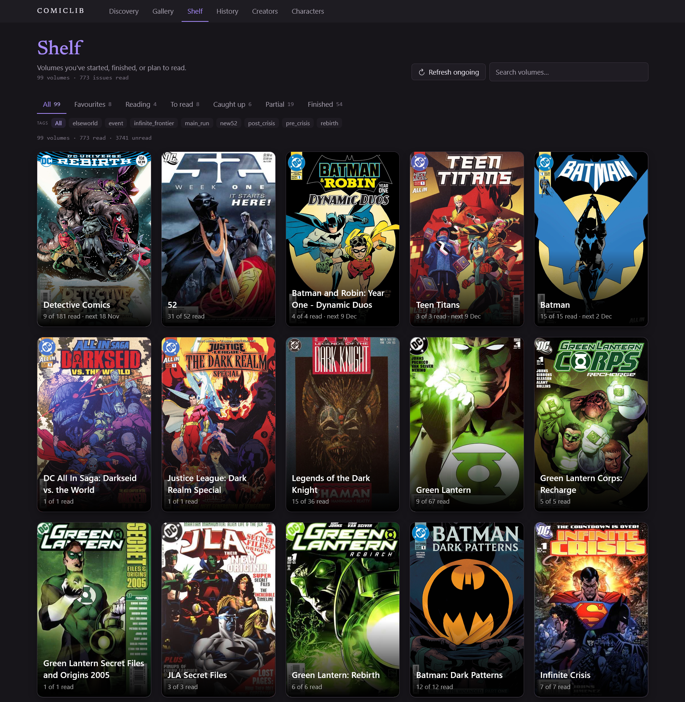

# ComicLib



A local-first, typed Node.js and React application built on top of the [ComicVine](https://comicvine.gamespot.com/) API. It started as a single function that answered one question: which issues contain these two characters together? It grew into a browsable catalogue, a reading tracker and a derived search system, all stored as plain JSON.

The comic data is the subject matter. The engineering is the point.

## What this project is for

I wanted a project where the interesting work is in the structure rather than the screens, and where a hobby gives me a real reason to care about the data. The goals were:

- Types first. Model the domain before touching the network, so every later layer has a contract to satisfy.
- Tests around pure logic. If a rule can be written as a function of data, it gets a test. Nothing in the suite mocks HTTP.
- Real API work: fetching, pacing, caching, narrowing untyped responses at a boundary, and coping with an API far less convenient than it looks.
- A Node server of my own. The browser speaks JSON only; the filesystem and the API key never leave the server.
- Heavy array work: filtering, grouping, joining and indexing thousands of records. Credits become creator indexes, character credits become co-occurrence queries, read marks become progress.

The result is a tool I use myself, in a codebase where each layer has one job.

## How it grew

The order matters. Each step added one new seam, and none of them required rewriting the previous one.

### 1. One file, a type, a query

The first version was a single file, `index.ts` (now [`model.ts`](model.ts)), holding the `Issue` type, four hand-written issues and a function:

```ts
characters.every(name => issue.characters.includes(name))
```

No network, no storage, no server. The core question was answerable and testable before a single HTTP request existed. I added Vitest and `tsc --noEmit` immediately, because `node index.ts` runs TypeScript natively but checks nothing, and the type checker is what keeps a model honest.

That seed is still in the repo as `tests/fixtures.ts`. It is a test fixture, never the dataset. Later, live data showed why the distinction mattered (see *Decisions that were reversed*).

### 2. Reshaping the model before the data arrived

Before connecting any API, the model went through a refactor, kept green by the tests throughout:

- **Issue number became numeric.** Sorting, ranges and counting come for free with a number.
- **Dates became ISO strings, not `Date` objects.** A publication date is a calendar date, not an instant. `new Date("2022-06-14")` parses as midnight UTC and renders as June 13 in any timezone behind UTC. Strings also compare by value, sort as text and survive JSON.
- **Era became a flat tag in `tags: string[]`**, never derived from a year window, because it is an editorial claim and not arithmetic.
- **`Volume` became its own type**, and issues point at it with a `volumeId`. The series name lives in one place instead of being repeated on every issue.

That produced the rule I used from then on: derive what's mechanical, store what's a judgment. A year is arithmetic on a date, so it is derived. An era is an opinion, so it is stored.

### 3. Real data, and the first hard seam

Replacing the fixture with ComicVine meant adding [`comicvine.ts`](comicvine.ts): fetchers, transforms and a disk cache. The raw API does not match the model. Dates are sometimes missing, issue numbers are strings, credits are a lowercase comma-joined role string, and descriptions run to hundreds of kilobytes of HTML. Every response is narrowed at one boundary (`withCredits`, `rawToVolume`, `rawToCharacter`), and the rest of the code only sees the model. Raw data is `any` at the edge and typed everywhere else.

The cache was deliberately dumb: one file per HTTP response, verbatim, disposable, gitignored. No schema, no migrations, no partial writes. The workflow followed from it. Save a response once, then iterate on the transforms offline against the saved file, because every live debug run spends from a small hourly request budget.

An early test of the architecture: real cached API data fed straight into the original `findIssues`. It worked unchanged, because the query cannot tell seed data from API data.

### 4. JSON in, JSON out

Once there was data, there was a reason for a browser to ask for it. [`server.ts`](server.ts) is a thin transport layer of routes returning JSON, and [`server-ui.ts`](server-ui.ts) serves the built UI with an SPA fallback. The rule held from day one: the UI never imports a Node module. `ui/src/types.ts` restates the wire types on purpose. The HTTP boundary is a real contract, so duplicating the shapes costs less than coupling the browser bundle to server internals.

The server also taught me a failure mode that happened three times. Writing `res.writeHead(200)` before an `await` that can throw means the error handler's own `writeHead(500)` throws `ERR_HTTP_HEADERS_SENT`, which is an unhandled rejection, which kills the process. One bad id took down the whole API. The rule became: resolve the value first, then write the header, then end.

### 5. Derived views over the cache

Creator search and character co-occurrence cannot be served by an endpoint, because the API has no way to ask for them. Both are pure indexes built over data already on disk. [`search.ts`](search.ts) builds a creator index and [`character.ts`](character.ts) builds a character index, each with a matching and grouping layer. Each does I/O in exactly one function (`getSearchContext`, `getCharacterContext`) and is pure everywhere else.

Details that came from reading real responses:

- `person_credits[].role` is a comma-joined string (`"artist, cover"`), so membership means split, then check tokens. A cover-only credit is not an artist.
- The creator index stores a per-issue role map, so "Writers" means issues where the person wrote, not every issue by someone who has ever written.
- Character search resolves an alias to a set of records, because aliases are many-to-many. "Robin" is several different people.

### 6. Storage as a sparse overlay

[`library.ts`](library.ts) holds the only data I own (read marks, volume flags, favourites, tags, editions) in a committed `library.json`. Everything from ComicVine is world data: disposable, regenerable, gitignored. Everything in `library.json` is my data: small, deliberate, committed.

```json
{
  "volumes": { "<id>": { "reading": true, "ongoing": true, "ignored": true } },
  "issues": { "<id>": { "readAt": "YYYY-MM-DD" } },
  "editions": { "<id>": { "name": "...", "format": "trade", "issues": [], "owned": true } }
}
```

Absence is the value. An unread issue is a missing key. The invariant that makes this work: the cache is never written by hand, and the library is never written by the API. A refetch cannot destroy an edit, because the edit was never in the same file. The merge happens at read time, in one testable function.

The file splits into a pure core, functions that take a `Library` object and touch no filesystem, and a thin shell (`readLibrary`, `writeLibrary`, `updateLibrary`). Every write re-reads the file before mutating, so a stale in-memory copy cannot clobber it.

Two details I like:

- **Volume state is derived, never stored.** A pure `volumeState(read, total, reading, ongoing)` produces six states from a bookmark, a read count and the volume's own extent.
- **Bulk edits are one write.** Marking forty issues read is a single `updateLibrary` call.

Favourites use the same overlay. Favourited volumes and creators are lists of ids in `library.json`, behind the same single writer.

### 7. A UI on top of a tested core

The React, Vite and Tailwind app came last, as a thin skin over an API that already worked. Pages are filters over the same endpoints: Discovery, Gallery, Shelf, Volume, Issue, History, Creators, Characters and Editions. Pages that share a rendering problem share a component, such as covers or range-collapsed issue pills like `#4-9`.

### 8. Deep fetches as a job, with a guard

Per-issue credits need one API call per issue, so filling a volume's details takes hours of calls at the rate limit. That work is a background job. It is resumable because skip-if-exists is the resume, with no separate progress file. It reports progress through a callback.

A later addition stops two automatic fetching jobs running at once. Job state lives in [`index-job.ts`](index-job.ts) and is checked before a new job starts, so the read-index job and the full-volume deep fetch share one pacing budget.

### 9. Exporting to my notes

A volume can be exported as copy-paste YAML frontmatter for an Obsidian note: title, year, publisher, writers, progress, and started and finished dates derived from the earliest and latest read dates. The export is one-directional, for the reason below.

### 10. Editions: books the API cannot see

I read in trades, hardcovers, compacts and omnibuses. ComicVine models those as separate volumes with their own issue ids, so pulling them would duplicate content and lose the per-issue grain. Editions live in `library.json` instead: a name, a format, `owned`, and a list of main-run issue ids. They span volumes by design, and an issue can sit in several editions, which is how a trade and an omnibus that collects it both stay true.

History groups each read issue under the smallest edition that contains it, and falls back to the volume when no edition does. An edition's cover is a chosen issue, defaulting to the first, and a stored `coverId` stops applying when that issue leaves the edition.

## Designing around the API's limits

ComicVine constrained the architecture more than any preference of mine did. Each limit forced a decision.

**`/issues` filters by volume, never by character or creator.** There is no way to ask "where do these two characters meet", so the headline feature cannot be a query. It is computed from issue details already on disk. That is why creator and character search only see deep-fetched issues, and why the UI states its coverage honestly ("599 of 599 read issues indexed") instead of implying it knows everything.

**List results carry no credits.** Only `/issue/4000-<id>/` returns people and characters, which splits the data into two layers: a cheap index (a volume response lists every issue stub and its characters with counts) and an expensive detail layer (one call per issue). The code and the UI keep `issuesKnown` (stubs) and `detailsCached` (deep-fetched) strictly apart, and the volume header reads `X of Y read · N details cached`.

**Roughly 200 requests per hour.** This shaped the whole application:

- **Discovery comes first.** One call to the publisher endpoint returns every DC volume, about 9,700 records. You browse locally instead of hitting the API per click.
- **Each API call lives in one place.** `comicvine.ts` is the only file that knows the API key or any cache filename, so pacing and skip-if-exists apply uniformly.
- **Deep fetches are a user action, never a side effect.** Viewing a page never triggers a fetch.
- **Jobs are staggered at 18 seconds per fresh response.** Cache hits do not sleep, so resuming a job over cached data is instant.

**Singular resources take no filters, and payloads are huge.** `field_list` keeps responses small. Character details omit `description` (one character's runs to about 397,000 characters of HTML) in favour of the short `deck`, and the HTML that does arrive is stripped at the boundary.

**The consequence: coverage is earned.** Reading a volume and indexing it are the same act, so the searchable set grows with what I care about rather than with the size of the catalogue.

## Decisions that were reversed

- **`kind` was removed from `Issue`.** I added `"issue" | "annual" | "special"` because annuals seemed to break numbering. Live responses showed ComicVine keeps annuals and specials as separate volumes, so the problem could not occur. The fixture had encoded an assumption the API falsified.
- **Issue ids come from ComicVine.** I wanted hand-readable ids for the seed, then realised I was generalising from a fixture to the app. The API's id is the key; a readable name is derived (`makeLabel`).
- **Obsidian import was dropped.** A note is a run, a trade or an event; the app's unit is one issue in one volume. Bridging them needed a parser, a resolver and a permanent manual-id habit. Export survived because it costs almost nothing.
- **No ratings.** A rating is a judgment for the note, not a per-issue number.
- **"Reading" moved from the issue to the volume.** An issue is read or unread. "Currently reading" is an intent, so it is a volume bookmark.
- **An early assumption about types was wrong.** I first wrote that ComicVine returns everything as strings. A live response showed it is mixed (`issue_number` is a string, `count_of_issues` is a number), so coercion happens per field.

## Structure

```
React pages (ui/src/pages)
  -> fetch /api/*
src/server.ts        transport: routes, JSON, access gate
src/server-ui.ts     static ui/dist + SPA fallback
src/index-job.ts     background job state (with the single-job guard)
src/http.ts          JSON response helper
src/session.ts       signed session token + cookie parsing (pure)
  -> src/comicvine.ts    HTTP fetchers, transforms, disk cache, memo layer
  -> src/library.ts      personal overlay: read marks, flags, favourites, tags, editions
  -> src/search.ts       derived creator index + queries
  -> src/character.ts    derived character index + queries
  -> src/model.ts        domain types + pure queries
scripts/launcher + ops scripts
cache/*.json + library.json
```

The rule at every line is who owns what:

- `src/model.ts` is the domain and does no I/O.
- `src/comicvine.ts` is the only file that knows cache filenames and the API key.
- `src/library.ts` is the only file that writes `library.json`.
- `src/server.ts` owns routing and never calls ComicVine directly.
- `src/session.ts` is pure token math; it never touches a request or a response.
- The UI never imports Node modules; `ui/src/types.ts` duplicates the wire shapes deliberately.

[ARCHITECTURE.md](ARCHITECTURE.md) has the full layer map, cache file formats and a where-to-add-what table.

## Performance: the in-memory cache

The derived views (creator index, character index, cached issue and volume lists) are built from hundreds of `issue-*.json` files. Reading and parsing all of them on every request is wasted work once they are on disk.

`src/comicvine.ts` keeps parsed results in a `Map` keyed by a list name and stamped with a module-level `cacheVersion`. Every write or delete bumps the version, which invalidates all entries at once. The next request rebuilds once and reuses the result until something changes. The derived index is still recomputed per request from the cached array, which is cheap CPU over data already in memory, and leaving it uncached means changes to `library.json` are never stale.

The mechanism is one map, one counter, one helper. A database is the heavier escape hatch if the data outgrows it, and SQLite fits this project better than a hosted Postgres: one file on disk, SQL when it is needed, no monthly cost.

## Testing

Tests live in `tests/` and cover the pure parts: all-characters matching, tag short-circuiting, the ISO date contract, label formatting, volume state derivation, read marks and bulk operations, progress, edition membership and edition progress, and creator indexing with role filtering. Nothing mocks HTTP. Transport is kept thin enough that there is little to test. `tsc --noEmit` runs clean at the root and in the UI, and a fixture saved from the API lets the transforms be tested offline.

## Running it

Requirements: Node 25 (native TypeScript stripping) and a ComicVine API key.

```powershell
npm install
npm --prefix ui install --include=dev
Copy-Item .env.example .env     # then set COMICVINE_API_KEY
npm run app                     # build UI, start server, open localhost:3001
```

On Windows, `scripts\launch.cmd` does the same in one click. For development, run the API and Vite separately:

```powershell
node --env-file=.env src/server.ts
npm --prefix ui run dev        # Vite proxies /api to :3001
```

Checks:

```powershell
npm run typecheck
npm test
npm --prefix ui run build
```

## Where this goes next

Everything planned is built. What remains are improvements to existing shapes: matching characters by id rather than name, retiring the test-only helpers once the seed no longer needs them, and moving the cache to SQLite behind the same `comicvine.ts` seam if the catalogue outgrows memory.
